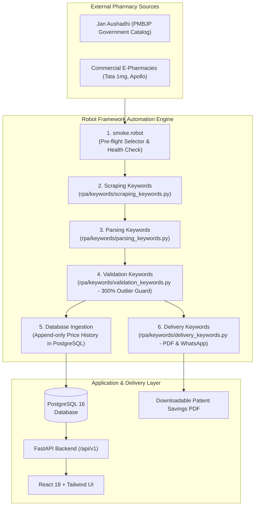

<div align="center">

# **GLS University**
### **Faculty Of Computer Applications & Information Technology**
### **iMCA Semester IX**
### **RPA Project – 2026-27**

</div>

---

<table width="100%" border="1" cellpadding="8" cellspacing="0" style="border-collapse: collapse; border: 1.5px solid black;">
  <tr>
    <td width="30%"><strong>Student 1 Name:</strong><br>Samarth Rajeshkumar Bhatt</td>
    <td width="20%"><strong>Mobile:</strong><br>9484873818</td>
    <td width="30%"><strong>Enrollment No:</strong><br>202202519010008</td>
    <td width="20%"><strong>Div_Roll no.:</strong><br>A08</td>
  </tr>
  <tr>
    <td><strong>Student 2 Name:</strong><br>VISHAL SUTHAR</td>
    <td><strong>Mobile:</strong><br>88902 00557</td>
    <td><strong>Enrollment No:</strong><br>202202519010088</td>
    <td><strong>Div_Roll no.:</strong><br>A88</td>
  </tr>
  <tr>
    <td colspan="4"><strong>Company/Organization Name:</strong> Not Applicable</td>
  </tr>
  <tr>
    <td colspan="4"><strong>Company Contact No:</strong> Not Applicable</td>
  </tr>
  <tr>
    <td colspan="4"><strong>Company Email Id:</strong> Not Applicable</td>
  </tr>
  <tr>
    <td colspan="4"><strong>Project Title:</strong> An RPA-Driven Medicine Price Intelligence & Generic Substitute Recommendation System (GenuineRx / SahiKimat)</td>
  </tr>
  <tr>
    <td colspan="4"><strong>Frontend Technologies:</strong> React.js, Tailwind CSS.</td>
  </tr>
  <tr>
    <td colspan="4"><strong>Backend Technologies:</strong> Python, FastAPI, Tesseract OCR, PostgreSQL.</td>
  </tr>
  <tr>
    <td colspan="4"><strong>RPA & Automation Technologies:</strong> Robot Framework 7.0+, Selenium / Playwright (Browser Library), RPA Framework (Robocorp), APScheduler.</td>
  </tr>
  <tr>
    <td colspan="4"><strong>List of Hardware / Sensor / Processor (if Project on Embedded System):</strong> Not Applicable</td>
  </tr>
  <tr>
    <td colspan="4">
      <strong>Project Description:</strong><br><br>
      India's out-of-pocket healthcare spending is dominated by medicine cost, and a large share of that cost is avoidable: a branded tablet and its generic equivalent can share the exact same salt and strength while differing in price by five to twenty times, yet a patient standing at a pharmacy counter has no practical way to know this in the moment they are asked to pay. The government's own Jan Aushadhi scheme already sells thousands of these generic equivalents at a fraction of branded prices through outlets spread across the country, but the information needed to connect a doctor's handwritten prescription to that cheaper option — salt composition, benchmark generic pricing, and live branded pricing — is scattered across sources that were never built to be compared against one another. Existing pharmacy platforms are not positioned to close this gap either, since their substitute-suggestion features exist to retain a sale within their own catalogue rather than to point a patient toward the objectively cheapest option.<br><br>
      <strong>GenuineRx (SahiKimat)</strong> is an RPA-driven medicine price intelligence platform designed to close this gap using a coordinated automation pipeline rather than a manually maintained comparison list. The platform accepts a medicine name typed by the user or photographed directly off a prescription or medicine strip, resolves it through OCR and fuzzy matching to its exact salt composition, and cross-references that composition against a locally-built substitute database to surface every brand — including Jan Aushadhi listings — that shares the identical salt and strength. A Robot Framework and RPA Framework automation layer runs on a scheduled cadence to keep this comparison current: it scrapes live branded prices from a primary pharmacy source, parses the official Jan Aushadhi price list, and validates every scrape against historical price bounds so that a broken page structure or a stale run is caught before it can corrupt a patient-facing recommendation.<br><br>
      The system's core contribution is this tested, schedulable RPA decision layer, which converts a scattered, one-time-lookup problem into a proactive, ranked savings recommendation — surfaced through a patient-facing web application that returns a rupee-and-percentage savings figure alongside every substitute, and delivers ongoing WhatsApp digests for a patient's tracked, recurring medications. An accompanying trust-and-safety layer keeps every recommendation grounded in exact salt-and-strength matching only, with a curated caution list for narrow-therapeutic-index drugs and a consistent prompt to confirm any brand switch with a pharmacist or doctor. While built and demonstrated at capstone stage against a defined set of common medicine categories and a single primary pharmacy source, the architecture is designed to generalize to national-scale medicine coverage and multi-source price tracking as a post-capstone product.
    </td>
  </tr>
  <tr>
    <td colspan="4">
      <strong>Project Modules:</strong><br><br>
      <strong>1. Prescription & Medicine Resolution Module</strong><br>
      Accepts a medicine name as typed text or as a photographed prescription/strip image, applying image pre-processing (deskew, contrast normalization) ahead of Tesseract OCR to handle handwritten and low-light inputs. Resolves noisy OCR output to a specific branded medicine using confidence-scored fuzzy matching, prompting the user for confirmation whenever the match confidence falls below a safe threshold rather than guessing silently.<br><br>
      <strong>2. RPA Price Intelligence & Scraping Module</strong><br>
      Runs a scheduled Robot Framework and RPA Framework pipeline that scrapes current branded medicine prices from a designated primary pharmacy source and parses the official Jan Aushadhi/BPPI generic price list from its published PDF, writing both into an append-only price-history store that anchors every later savings calculation.<br><br>
      <strong>3. Salt Composition Normalization & Substitute Matching Module</strong><br>
      Normalizes raw salt-composition text into standardized (salt name, strength, unit) tuples, resolving common abbreviations and spelling variants, and represents each medicine — including multi-salt combination drugs — as an order-independent set for exact matching. Queries the substitute database for every brand sharing an identical salt-and-strength set and ranks results with Jan Aushadhi/generic options surfaced ahead of costlier branded alternatives.<br><br>
      <strong>4. Robot Framework Test & Validation Module</strong><br>
      Maintains a dedicated keyword-driven test suite — smoke tests that confirm target page structures before a scheduled scrape runs, data-sanity tests that reject implausible or empty scrape results, and regression tests against a fixed set of known medicine cases — so that the reliability of the automation itself, not only the recommendation output, is demonstrable and auditable.<br><br>
      <strong>5. Savings Calculation & Alerts Module</strong><br>
      Computes rupee and percentage savings for every resolved substitute relative to the patient's original branded medicine, and delivers scheduled WhatsApp/SMS digests covering price changes and refill reminders for a patient's tracked, recurring medications, including separate profiles for dependent family members.<br><br>
      <strong>6. Trust & Safety Module</strong><br>
      Constraints every recommendation to exact salt-and-strength matches only, maintains a manually curated caution list for narrow-therapeutic-index drugs requiring closer medical supervision before any brand switch, and displays a consistent pharmacist/doctor-confirmation prompt alongside every substitute result.
    </td>
  </tr>
</table>

<br>

---

## 📑 Detailed Technical Documentation (Soft Copy Supplement)

### 1. Technology Stack Breakdown

| Layer | Technology | Purpose in System |
|---|---|---|
| **RPA & Test Automation** | **Robot Framework 7.0+** + **RPA Framework (Robocorp)** | Core test orchestration, keyword execution, and test reports |
| **Browser Automation** | **Browser Library (Playwright-backed)** / SeleniumLibrary | Headless crawling, dynamic page rendering, and DOM scraping |
| **Backend API** | **FastAPI (Python 3.11)** | High-performance asynchronous REST endpoints |
| **Computer Vision / OCR** | **Tesseract OCR + OpenCV** | Image deskewing, CLAHE contrast enhancement, and text reading |
| **Database** | **PostgreSQL 16** | Relational data store for medicines, salts, price history, and users |
| **Frontend UI** | **React.js 18 + Tailwind CSS + Vite** | Responsive patient search interface and family savings dashboard |
| **Task Scheduling** | **APScheduler** | Unattended background automated cron runs (daily at 02:00 AM IST) |
| **Reporting Engine** | **fpdf2** | Pure Python A4 patient savings audit report generator |

---

### 2. RPA Architecture & Execution Workflow



---

### 3. Detailed Custom Keyword Specifications

All keyword implementations reside in `rpa/keywords/`:

| Keyword Name | File | Signature | Detailed Functionality |
|---|---|---|---|
| **`Open Pharmacy Source`** | `scraping_keywords.py` | `(url: str) -> None` | Launches browser with desktop user-agent, manages cookies, and waits for DOM idle. |
| **`Scrape Medicine Page`** | `scraping_keywords.py` | `(product_url: str) -> dict` | Extracts `{name, mrp, price, raw_salt_text}`. Raises `ScrapeStructureError` if selectors are missing. |
| **`Normalize Salt String`** | `parsing_keywords.py` | `(raw: str) -> list[tuple]` | Pure normalization function: tokenizes salts, resolves brand aliases, and standardizes all units to metric mg. |
| **`Validate Price Sanity`** | `validation_keywords.py` | `(medicine_id: int, new_price: float) -> bool` | Statistical outlier rejection: flags deviations > 300% or zero/negative prices against a 7-day moving window. |
| **`Parse Jan Aushadhi PDF`** | `parsing_keywords.py` | `(pdf_path: str) -> list[dict]` | Reads official PMBJP PDF tables using `RPA.PDF` and outputs normalized catalog records. |
| **`Send WhatsApp Digest`** | `delivery_keywords.py` | `(user_id: int, items: list) -> None` | Builds localized savings summary and triggers WhatsApp dispatch if `consent_whatsapp=True`. |
| **`Generate Savings PDF`** | `api/pdf_report.py` | `(user_id: int) -> str` | Renders a professional, printable A4 savings breakdown report using `fpdf2`. |

---

### 4. Robot Framework Test Suites Overview

The automated suite is organized under `rpa/suites/`:

1. **`smoke.robot`**: Runs in <30 seconds before every scheduled crawl. Tests web selector resolution on target pharmacy pages. Fails fast if target markup has shifted.
2. **`price_tracking.robot`**: Iterates across tracked medications, navigates pages, extracts current commercial prices, and logs price differences.
3. **`daily_scheduler.robot`**: Verifies that the APScheduler unattended background loop fires predictably and executes ingestion jobs without memory leaks.
4. **`data_sanity.robot`**: Executes `Validate Price Sanity` on newly scraped batches. Implausible spikes or zeroes trigger an immediate suite failure.
5. **`regression.robot`**: Offline regression suite testing 15+ known, complex multi-salt formulations against canonical reference outputs.
6. **`end_to_end.robot`**: Complete simulation of prescription photo → OCR → match → substitute recommendation → PDF savings report.
7. **`api_smoke.robot`**: Validates all FastAPI endpoints (`/search`, `/substitutes`, `/users/{id}/savings-report`) for 200 OK responses and proper JSON schemas.

---

### 5. Step-by-Step Execution Guide for Evaluation

```powershell
# 1. Activate Environment
cd c:\Users\samarth10\.gemini\antigravity-ide\scratch\genuine-rx
.venv\Scripts\activate

# 2. Run Smoke Suite (<30s)
python -m robot -d rpa/reports rpa/suites/smoke.robot

# 3. Run Price Tracking & Sanity Suite
python -m robot -d rpa/reports rpa/suites/price_tracking.robot
python -m robot -d rpa/reports rpa/suites/data_sanity.robot

# 4. Run End-to-End Suite
python -m robot -d rpa/reports rpa/suites/end_to_end.robot

# 5. Run Full Robot Framework Test Suite
python -m robot -d rpa/reports rpa/suites/
```

Test results, visual execution trees, and logs are automatically generated at:
- `rpa/reports/log.html`
- `rpa/reports/report.html`

---

<div align="center">
  <sub><strong>GLS University — Faculty Of Computer Applications & Information Technology — iMCA Semester IX (2026-27)</strong></sub>
</div>
